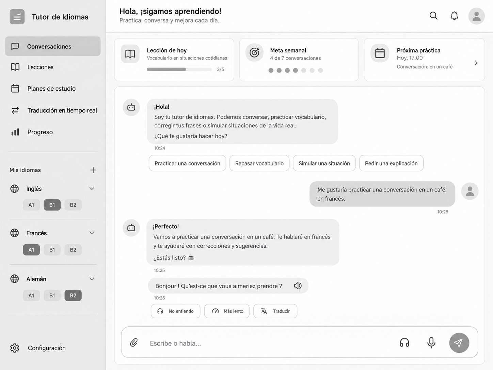

# Tutor de Idiomas — `desing.md`

> **Documento de referencia de diseño para agentes de desarrollo.**
> Estado: wireframe / planificación. Idioma de la interfaz: **español**.
> Objetivo: construir una **PWA de escritorio, adaptable a móvil**, sencilla y centrada en conversaciones, con una organización visual inspirada en la simplicidad de ChatGPT, pero con identidad y componentes propios.



## 1. Visión del producto

Una aplicación de aprendizaje de idiomas guiada por un agente de IA que permite:

- Conversar con un tutor por **texto o voz**.
- Practicar mediante lecciones y ejercicios ajustados al nivel.
- Crear y seguir **planes de estudio** con metas y sesiones.
- Traducir texto y voz, incluyendo un **modo intérprete en tiempo real**.
- Llevar progreso, historial, errores frecuentes y vocabulario **por idioma**.
- Instalar la experiencia como **PWA** en el ordenador y utilizarla desde el móvil.

**Principio rector:** el chat es el centro de la experiencia. Las otras funciones complementan las conversaciones, no las complican.

## 2. Objetivos del diseño

1. **Familiaridad:** estructura de barra lateral + contenido principal + compositor inferior.
2. **Simplicidad:** acciones frecuentes visibles; funcionalidades avanzadas bajo menús o paneles.
3. **Continuidad:** al entrar en un idioma, retomar su última conversación, lección o plan.
4. **Contexto claro:** mostrar siempre qué idioma y qué nivel se están practicando.
5. **Voz como primera clase:** micrófono, reproducción, velocidad y traducción accesibles sin navegar fuera del chat.
6. **Consistencia:** mismo sistema de componentes en todas las secciones.
7. **Prototipo primero:** empezar con una interfaz monocromática funcional y validar flujos antes de definir marca y colores definitivos.

## 3. Dirección visual

### Estilo

- **Minimalista, monocromático, limpio**, con sensación de aplicación productiva.
- Fondos claros, bordes sutiles, mucho espacio en blanco.
- Bordes redondeados discretos; sin degradados fuertes ni efectos llamativos.
- Íconos lineales coherentes (por ejemplo, Lucide).
- Evitar ilustraciones decorativas, avatares realistas y paneles innecesarios.
- No copiar logotipos ni componentes propietarios de ninguna plataforma.

### Tokens sugeridos para el wireframe

| Token | Valor sugerido | Uso |
|---|---|---|
| `--bg-app` | `#FFFFFF` | Fondo principal |
| `--bg-sidebar` | `#F5F5F5` | Barra lateral |
| `--bg-surface` | `#FAFAFA` | Tarjetas y bloques secundarios |
| `--bg-hover` | `#ECECEC` | Hover / selección suave |
| `--bg-user-message` | `#EDEDED` | Mensajes de usuario |
| `--text-primary` | `#171717` | Títulos y contenido |
| `--text-secondary` | `#666666` | Información secundaria |
| `--border-subtle` | `#E5E5E5` | Bordes y separadores |
| `--accent-neutral` | `#555555` | Botón principal y estado activo |
| `--radius-sm` | `8px` | Chips y botones pequeños |
| `--radius-md` | `12px` | Botones y tarjetas |
| `--radius-lg` | `18px` | Contenedores principales |
| `--radius-pill` | `999px` | Compositor y píldoras |

Estos valores son **referencias iniciales**, no decisiones inamovibles. La versión inicial debe mantenerse en grises.

### Tipografía y espaciado

- Fuente: **Inter** o una sans-serif de sistema equivalente.
- Base: **15–16px**; metadatos: **12–13px**; encabezados: **20–24px**.
- Pesos: 400 para cuerpo, 500 para controles, 600 para títulos.
- Escala de espacio: **4 / 8 / 12 / 16 / 24 / 32px**.
- Altura cómoda para pulsación: **40–44px** como mínimo en controles importantes.
- Ancho óptimo del contenido de conversación: **760–900px**, centrado dentro del área principal.

## 4. Arquitectura de información

### Navegación principal (sidebar)

1. **Conversaciones** — chat de tutoría e historial.
2. **Lecciones** — catálogo, próxima lección y ejercicios.
3. **Planes de estudio** — objetivos, planificación y tareas pendientes.
4. **Traducción en tiempo real** — modo traductor e intérprete.
5. **Progreso** — métricas, vocabulario y evolución.

**Debajo de la navegación:**

- Sección **Mis idiomas** con acción `+` para añadir otro idioma.
- Cada idioma muestra su nombre, nivel actual y un desplegable para sus conversaciones o acceso a su espacio.
- Ejemplos del wireframe: **Inglés · B1**, **Francés · A1**, **Alemán · B2**.
- Solo **un idioma activo** a la vez. Los niveles A1–C2 representan la progresión del usuario; no son tres niveles seleccionados simultáneamente.
- **Configuración** fijada al pie de la barra lateral.

### Rutas conceptuales

| Ruta | Vista |
|---|---|
| `/` | Inicio de conversaciones: tarjetas de resumen e historial del idioma activo |
| `/chat` | Redirección a `/` (ruta heredada) |
| `/chat/:conversationId` | Conversación abierta: hilo y compositor |
| `/lessons` | Lecciones del idioma activo |
| `/plans` | Planes de estudio |
| `/translate` | Traducción e intérprete |
| `/progress` | Progreso del idioma activo |
| `/languages` | Gestión de idiomas |
| `/settings` | Preferencias |

Las rutas de las secciones son orientativas; pueden cambiar según la tecnología usada.
La separación entre **inicio** (`/`) y **conversación** (`/chat/:conversationId`) es una decisión
registrada (ADR-011): las tarjetas de resumen nunca se dibujan sobre el chat.

## 5. Layout principal — escritorio

### Estructura

Inicio (`/`): tarjetas de resumen, aviso de datos de ejemplo e historial del idioma activo.

```text
┌────────────────────┬───────────────────────────────────────────────────────────┐
│ Tutor de Idiomas   │ Hola, ¡sigamos aprendiendo!             Buscar / Perfil   │
│                    ├───────────────────────────────────────────────────────────┤
│ Conversaciones     │ [ Lección de hoy ] [ Meta semanal ] [ Próxima práctica ]  │
│ Lecciones          │                                                           │
│ Planes de estudio  │   Aviso: datos de ejemplo, sin backend todavía            │
│ Traducción         │                                                           │
│ Progreso           │   Conversaciones en Francés           [Nueva conversación]│
│ ─────────────────  │   ┌───────────────────────────────────────────────────┐   │
│ Mis idiomas      + │   │ En un café · 3 mensajes · último 10:25        →   │   │
│  Inglés · B1       │   └───────────────────────────────────────────────────┘   │
│  Francés · A1      │                                                           │
│  Alemán · B2       │                                                           │
│                    │                                                           │
│ Configuración      │                                                           │
└────────────────────┴───────────────────────────────────────────────────────────┘
```

Conversación (`/chat/:conversationId`): solo hilo y compositor; sin tarjetas.

```text
┌────────────────────┬───────────────────────────────────────────────────────────┐
│ Tutor de Idiomas   │ Hola, ¡sigamos aprendiendo!             Buscar / Perfil   │
│                    ├───────────────────────────────────────────────────────────┤
│ Conversaciones     │   Tutor: ¡Hola! ¿Qué te gustaría practicar hoy?           │
│ Lecciones          │          [Conversar] [Vocabulario] [Simular]              │
│ Planes de estudio  │                                                           │
│ Traducción         │                          Tú: Quiero practicar francés.    │
│ Progreso           │                                                           │
│ ─────────────────  │   Tutor: ¡Perfecto! ...                                   │
│ Mis idiomas      + │   Bonjour ! ... [Audio]                                   │
│  Inglés · B1       │   [No entiendo] [Más lento] [Traducir]                    │
│  Francés · A1      │                                                           │
│  Alemán · B2       │ ┌───────────────────────────────────────────────────────┐ │
│                    │ │ Escribe o habla...             [Voz] [Mic] [Enviar]   │ │
│ Configuración      │ └───────────────────────────────────────────────────────┘ │
└────────────────────┴───────────────────────────────────────────────────────────┘
```

### Medidas orientativas

- Sidebar: **260–300px**; puede contraerse a modo íconos u ocultarse.
- Cabecera: **64–80px** de alto.
- Área principal: ocupa el resto del ancho, sin un panel lateral permanente.
- Tarjetas de resumen: fila de **3 tarjetas** en la pantalla de inicio; nunca sobre la conversación.
- Chat: zona de mensajes con scroll independiente y compositor pegado abajo.
- Compositor: siempre visible mientras se conversa, respetando el teclado y las áreas seguras.
- Cada bloque del área principal ocupa su **propia fila** de la grilla: nada de contenido que se dibuje encima de otro bloque, y nada fuera del viewport.

## 6. Especificación de pantallas

### 6.1 Conversaciones — inicio y conversación

**Objetivo:** empezar o continuar una práctica con la menor fricción posible.

Son dos pantallas distintas (ADR-011). El inicio reúne el estado del día y el historial; la conversación
reúne el hilo y el compositor. Ninguna pantalla dibuja su contenido sobre la otra.

**Cabecera (común a las dos):**
- Saludo breve: «Hola, ¡sigamos aprendiendo!».
- Subtítulo: «Practica, conversa y mejora cada día».
- Acciones: búsqueda, notificaciones (si se implementan), usuario.
- Indicador visible del **idioma activo y nivel**, especialmente si hay varios idiomas.

#### 6.1.1 Inicio (`/`)

**Tarjetas de resumen (solo en esta pantalla):**
- **Lección de hoy:** nombre breve, progreso (ej. 3/5), acceso a continuar.
- **Meta semanal:** estado (ej. 4 de 7 conversaciones) y representación visual sencilla.
- **Próxima práctica:** fecha, hora y tema; acceso a iniciar o revisar.

**Nuevo chat e historial:**
- Botón destacado pero discreto «Nueva conversación».
- Agrupar o filtrar historial por idioma: la lista muestra **solo** las conversaciones del idioma activo.
- Títulos breves generados automáticamente, renombrables por el usuario.
- Cada fila del historial abre su conversación en `/chat/:conversationId`.
- Estado vacío explícito cuando el idioma activo todavía no tiene conversaciones.

#### 6.1.2 Conversación (`/chat/:conversationId`)

**Zona de mensajes:**
- Mensajes del tutor alineados a la izquierda; los del usuario a la derecha.
- Fondo del tutor blanco o gris muy tenue; mensaje del usuario gris suave.
- Texto con altura de línea cómoda, ancho máximo para facilitar lectura.
- Marca de tiempo discreta cuando aporte valor.
- Respuestas del tutor pueden incluir **audio, ejercicios, traducciones, correcciones o tarjetas de vocabulario**.
- Sugerencias rápidas después de un mensaje: «Practicar una conversación», «Repasar vocabulario», «Simular una situación», «Pedir una explicación».
- Ante frases del tutor: «No entiendo», «Más lento», «Traducir» y botón para volver a escuchar.
- «Traducir» traduce **el mensaje completo**, sin reemplazar el original, o **solo el fragmento
  seleccionado** dentro de esa burbuja cuando hay una selección; el panel cita entonces el fragmento
  traducido. La traducción del fragmento no se conserva al recargar; la del mensaje sí (ADR-014).
- La zona de mensajes tiene scroll propio: el hilo nunca se dibuja encima del aviso ni del compositor.

**Compositor inferior:**
- Placeholder: «Escribe o habla…».
- Acciones: adjuntar (solo si está soportado), iniciar modo voz, grabar voz, enviar.
- `Enter` envía; `Shift + Enter` inserta salto de línea.
- Botones deshabilitados cuando la acción no corresponda; no usar controles decorativos que aparenten funcionar.
- Mostrar estado «Escuchando…», «Transcribiendo…», «Pensando…» o «Reproduciendo…» según el flujo real.
- Siempre visible mientras se conversa: el aviso de prototipo, si aparece, va arriba del compositor, dentro de la misma fila.

**Conversación inexistente:** estado de error con recuperación explícita (volver al inicio), sin inventar datos.

### 6.2 Lecciones

**Objetivo:** mostrar el siguiente paso de aprendizaje y permitir completar sesiones estructuradas.

- Cabecera con idioma y nivel actual.
- Tarjeta destacada **Continuar aprendiendo**.
- Lista de unidades: vocabulario, gramática, pronunciación, escucha y práctica situacional.
- Cada lección muestra título, tipo, dificultad, duración estimada y estado.
- Vista de lección con contenido corto, práctica interactiva y feedback del tutor.
- Al finalizar: resultado, errores relevantes, vocabulario nuevo y próxima recomendación.

### 6.3 Planes de estudio

**Objetivo:** transformar una meta en una ruta de aprendizaje personalizada.

- Mostrar **objetivo** (ej. «Pasar de A1 a B1 en francés»).
- Frecuencia de estudio y tiempo diario configurables.
- Calendario o cronograma sencillo por semanas.
- Lista de sesiones con estado: pendiente, en curso, completada.
- Acción primaria «Continuar plan» y acción secundaria «Ajustar plan».
- El tutor puede **proponer** cambios basados en el rendimiento; mostrar los cambios importantes al usuario para aceptarlos.

### 6.4 Traducción en tiempo real

**Objetivo:** traducir texto o voz sin mezclar ese flujo con una lección.

**Dos modos separados:**

1. **Traducir texto:** idioma origen/destino, entrada, traducción, copiar y reproducir audio.
2. **Intérprete de voz:** controles para iniciar / detener escucha; transcripción original y traducción por segmentos; reproducción opcional del resultado.

**Elementos específicos del modo intérprete:**
- Selector de idioma de origen y destino, con opción de detección automática si está disponible.
- Señal clara de que el micrófono está activo.
- Historial de fragmentos originales y traducidos, ordenados temporalmente.
- Estados: sin permiso, conectado, escuchando, procesando, error, detenido.
- Nota visible de que la latencia y la precisión varían según el audio y la conexión.
- No grabar ni conservar audio sin informar de ello y ofrecer controles apropiados.

### 6.5 Progreso

**Objetivo:** dar feedback útil sin convertir el producto en un dashboard recargado.

- Resumen del idioma activo: nivel, sesiones completadas, tiempo practicado y meta semanal.
- Evolución por destreza: lectura, escucha, conversación, escritura, vocabulario.
- Lista de **errores frecuentes** y elementos por repasar.
- Historial de prácticas y lecciones.
- Cambios de nivel basados en una evaluación explícita o criterios trazables; evitar presentar el nivel como una medición infalible.

### 6.6 Mis idiomas

- Añadir o archivar idiomas.
- Configurar idioma de aprendizaje, idioma de explicación y nivel inicial.
- Al seleccionar un idioma, actualizar el contexto de chat, lecciones, planes y progreso.
- Mantener **datos e historial independientes por idioma**.
- Permitir cambiar de idioma sin perder la conversación anterior.

### 6.7 Configuración

- Preferencias del tutor: correcciones inmediatas o al final, formalidad, ritmo, dificultad.
- Preferencias de voz: voz disponible, velocidad de reproducción, subtítulos.
- Privacidad: historial, audio y permisos de micrófono.
- Preferencias generales: tema (más adelante), idioma de la interfaz, notificaciones.

## 7. Modos de conversación

El chat principal mantiene una estructura única, pero puede iniciar distintas actividades:

| Modo | Propósito | Controles esenciales |
|---|---|---|
| Chat libre | Conversar sobre cualquier tema | Texto, voz, sugerencias |
| Práctica guiada | Trabajar un objetivo concreto | Instrucciones, correcciones, siguiente paso |
| Roleplay | Simular café, aeropuerto, entrevista, etc. | Escenario, personaje, dificultad |
| Ejercicio | Resolver una actividad puntual | Responder, pista, comprobar |
| Voz en vivo | Conversación oral continua | Micrófono, silenciar, finalizar, subtítulos |

**Importante:** el modo «voz en vivo» y el modo «intérprete» pueden reutilizar componentes de audio, pero son flujos distintos. No asumir que ambos serán técnicamente idénticos.

## 8. Comportamientos y estados

### Acciones principales

- Seleccionar idioma → cambia el **contexto activo**, no elimina ni mezcla conversaciones.
- Seleccionar nivel → si se permite cambiarlo, debe hacerse en una acción explícita de configuración o evaluación; mostrar el nivel actual como dato, no como un simple filtro cualquiera.
- Iniciar conversación → crea una sesión asociada al idioma elegido.
- Iniciar voz → solicitar permiso de micrófono cuando corresponda y mostrar estado visible.
- Pulsar «Más lento» → reproducir o generar la frase a menor velocidad.
- Pulsar «Traducir» → mostrar la traducción de ese mensaje, sin reemplazar permanentemente el original.
  Si hay texto seleccionado dentro del mensaje, traduce solo esa selección, que se cita junto a la
  traducción para no confundirla con el mensaje entero.
- Pulsar «No entiendo» → pedir una explicación más simple y adaptada al nivel.
- Completar lección → guardar resultado y actualizar el progreso correspondiente.

### Estados que deben diseñarse

- Primer uso: ningún idioma añadido.
- Idioma añadido, sin conversaciones.
- Chat vacío / chat con historial.
- Cargando respuesta o conectando audio.
- Error de red o fallo del modelo.
- Permiso de micrófono denegado.
- Sin lecciones o sin plan de estudio.
- Sin datos suficientes para calcular progreso.
- Sesión de intérprete en curso / pausada / terminada.

Mostrar mensajes de error claros y acciones de recuperación como «Reintentar», «Volver a escribir» o «Revisar permisos».

## 9. Diseño responsive y PWA

### Escritorio (≥ 1024px)

- Sidebar persistente a la izquierda.
- Tarjetas de resumen en tres columnas cuando el espacio lo permita, en la pantalla de inicio.
- Chat central con ancho contenido.
- Compositor fijo en la parte inferior del área de chat.

### Tablet (768–1023px)

- Sidebar colapsable.
- Tarjetas de resumen en una o dos columnas, en la pantalla de inicio.
- Priorizar el contenido del chat y la entrada de texto.

### Móvil (< 768px)

- Sidebar como **drawer** accesible mediante menú.
- Cabecera compacta con idioma activo.
- Resúmenes apilados en una columna en la pantalla de inicio; la pantalla de conversación **no** muestra tarjetas.
- Compositor y botones táctiles adaptados a pantalla pequeña.
- Área de mensajes preparada para la aparición del teclado virtual.
- Modo voz con controles grandes para iniciar, silenciar y finalizar.

### Requisitos PWA

- Instalable en escritorio y móvil (manifest, íconos, metadatos adecuados).
- Diseño a pantalla completa en modo standalone.
- Estado visible cuando no hay conexión.
- La carcasa de la app puede estar disponible offline; **no prometer conversación o traducción offline** sin modelos locales adecuados.
- Respetar permisos de micrófono y capacidades disponibles del navegador.

## 10. Componentes UI reutilizables

| Componente | Uso |
|---|---|
| `AppShell` | Layout general |
| `Sidebar` / `SidebarNavItem` | Navegación |
| `LanguageSwitcher` / `LanguageItem` | Idiomas activos y nivel |
| `TopBar` | Cabecera y acciones |
| `SummaryCard` | Lección, meta, próxima práctica |
| `ChatThread` / `ChatMessage` | Conversaciones |
| `QuickActionChip` | Acciones contextuales |
| `ChatComposer` | Texto, voz y envío |
| `AudioMessagePlayer` | Reproducir / repetir audio |
| `VoiceSessionControls` | Llamada con tutor |
| `LessonCard` / `ExerciseBlock` | Lecciones |
| `StudyPlanTimeline` | Planificación |
| `TranslationPanel` / `LiveTranscript` | Traducción |
| `ProgressSummary` | Seguimiento |
| `EmptyState` / `ErrorState` | Estados generales |

**Regla:** reutilizar botones, cards, inputs, tipografía y espaciados; no crear estilos divergentes por pantalla.

## 11. Accesibilidad y detalles UX

- Contraste suficiente entre texto y fondo, incluso en tonos grises.
- Navegación por teclado, foco visible y etiquetas accesibles para íconos.
- Objetivos táctiles cómodos; tooltips para acciones solo con ícono.
- Transcripción visible como alternativa al audio.
- No depender exclusivamente de sonido o color para comunicar estados.
- Respetar preferencia de movimiento reducido.
- Confirmar acciones destructivas (eliminar idioma, historial, plan).
- Evitar interrupciones constantes del tutor durante una conversación; el nivel de corrección es configurable.

## 12. Integración con el agente de IA

La interfaz debe ser **independiente del harness**. El agente podría ejecutarse sobre **Pi, OpenCode u otra solución**, pero la PWA no debería acoplar sus componentes a uno solo.

Separar conceptualmente:

1. **Frontend PWA:** pantallas, controles, reproducción de audio, estados.
2. **Backend/API:** autenticación opcional, persistencia, sesiones, permisos y streaming.
3. **Tutor agente:** planificación, correcciones, herramientas educativas, memoria contextual.
4. **Capa de voz:** captura, transcripción, síntesis y/o audio en tiempo real.
5. **Datos:** idiomas, niveles, historial, lecciones, planes y progreso.

**No asumir** que Pi u OpenCode proveen por sí solos audio bidireccional de baja latencia. Esa capacidad requerirá validación y posiblemente un canal de voz específico.

### Datos mínimos que el diseño necesita

- `LanguageProfile`: idioma, nivel, preferencias y meta.
- `Conversation`: idioma, modo, título, mensajes y fecha.
- `Message`: autor, contenido, traducción opcional, audio opcional y estado.
- `Lesson`: idioma, tema, dificultad, ejercicios y resultado.
- `StudyPlan`: objetivo, frecuencia, hitos y actividades.
- `Progress`: habilidades, sesiones, vocabulario y errores recurrentes.

Son conceptos de producto, **no un esquema de base de datos definitivo**.

## 13. Alcance recomendado para la primera versión visual

**Primero diseñar y validar:**

1. Shell PWA con sidebar, cabecera y navegación.
2. Pantalla de conversación completa, con mensajes y compositor.
3. Selector de idioma con contexto persistente.
4. Pantallas base de lecciones, planes, traducción y progreso.
5. Estados vacíos, cargas, errores y responsive.

**Después conectar progresivamente:** chat real, almacenamiento, generación de lecciones, voz, traducción continua y personalización automática.

**Fuera del primer wireframe:** pagos, gamificación extensa, redes sociales, marketplace, personajes 3D, analíticas complejas y una identidad de marca definitiva.

## 14. Criterios de aceptación del diseño

- [ ] La aplicación se percibe simple, limpia y centrada en el chat.
- [ ] Sidebar con todas las secciones principales y apartado **Mis idiomas**.
- [ ] La pantalla principal refleja el wireframe de referencia.
- [ ] Se distingue de forma evidente el idioma activo y su nivel.
- [ ] Es posible iniciar una conversación nueva y encontrar las anteriores.
- [ ] El compositor contiene acciones de texto y voz bien identificadas.
- [ ] Los controles de traducción y repetición de audio son claros.
- [ ] Lecciones, planes, traducción y progreso tienen vistas consistentes.
- [ ] Existe diseño responsive para escritorio y móvil.
- [ ] Los estados vacíos, de carga, de error y de permisos están contemplados.
- [ ] Ningún botón visual implica una función inexistente sin indicar que es prototipo.
- [ ] El frontend no depende de un harness concreto.

## 15. Instrucciones para los agentes que construyan la interfaz

- Usar este documento y el **wireframe adjunto** como **fuente de verdad visual inicial**.
- No reinterpretar la plataforma como un dashboard complejo: **mantener el chat como centro**.
- Priorizar fidelidad en estructura, jerarquía y espaciado frente a efectos visuales.
- Implementar componentes reutilizables, accesibles y responsivos.
- Mantener copy e interfaz en **español**; los contenidos educativos pueden estar en cualquier idioma.
- Evitar introducir funciones, dependencias o integraciones no acordadas.
- Si todavía no existe backend, emplear **datos de ejemplo claramente identificados** y conservar la posibilidad de integrar el agente posteriormente.
- Separar la propuesta visual de decisiones todavía pendientes (framework, base de datos, proveedor de modelos y arquitectura de audio).

---

**Referencia visual:** `grayscale_language_tutor_chat_ui.png`  
**Nombre de entrega solicitado:** `desing.md`  
**Estado:** propuesta inicial, abierta a iteraciones.
